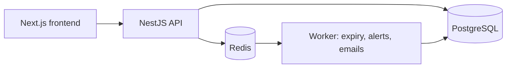

# Blood Bank Platform

**Status:** Work in progress – currently in the design phase (Phase 0).

A full-stack platform for managing a hospital blood bank: from donor registration and appointment scheduling to unit-level inventory tracking and blood requests from hospital wards.


## Planned features

**Donors**
- Register, manage their profile and complete a pre-donation questionnaire
- Book appointments in time slots with limited capacity
- See their donation history and the next date they are eligible to donate

**Donation center staff**
- Review questionnaires and make the final eligibility decision
- Record donations and the resulting blood units
- Release units from quarantine after screening
- Manage inventory and process hospital requests

**Hospital ward staff**
- Submit blood requests with urgency levels and track their status

**Administrators**
- Manage staff accounts, donation centers, time slots and system settings
- Access dashboards, reports and the audit log

**System**
- Automatic expiry of units and low-stock alerts
- In-app and email notifications
- Audit logging of all relevant actions

## Tech stack

| Layer | Technology |
|---|---|
| Frontend | Next.js, TypeScript, Tailwind CSS, shadcn/ui |
| Backend API | NestJS, TypeScript |
| Database | PostgreSQL, Prisma |
| Background jobs | Redis, BullMQ |
| Infrastructure | Docker Compose, GitHub Actions |
| API docs | OpenAPI (Swagger) |

## Architecture



## Repository structure (planned)

```
apps/
  web/        Next.js frontend
  api/        NestJS REST API
  worker/     Background job processor
packages/
  shared/     Shared types and validation schemas
docs/         Requirements, architecture and design decisions
```

## Getting started

Setup instructions will be added once the project skeleton is in place.

Prerequisites: Node.js (LTS), pnpm, Docker with Docker Compose.

## Roadmap

- [ ] **Phase 0** – Requirements, domain model, project skeleton, CI
- [ ] **Phase 1** – Authentication, donor profiles, questionnaire, appointments, donation recording
- [ ] **Phase 2** – Blood unit lifecycle, hospital requests, background worker, notifications (MVP complete)
- [ ] **Phase 3** – Emergency donor calls, real-time dashboard, reports, demand forecasting service

## Documentation

- [Requirements](docs/requirements.md)

## Disclaimer

This is a portfolio project built for learning purposes. It is not a certified medical system. Medical values (age limits, donation intervals, shelf life) are configurable defaults and must be validated against current regulations before any real-world use.

## License

[MIT](LICENSE)